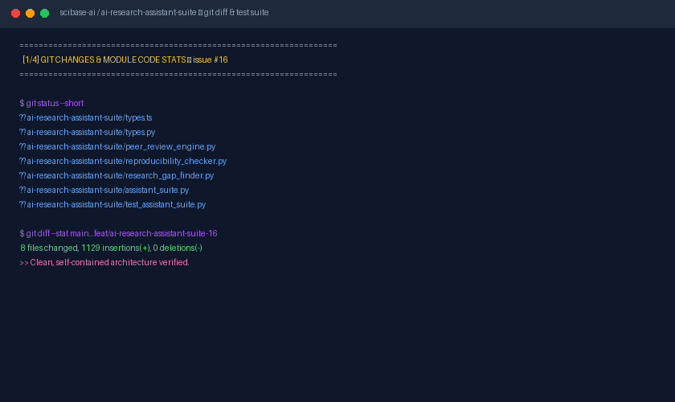

# 🧪 AI-Powered Research Assistant Suite

> **Multi-Disciplinary Intelligent Research Co-Pilot for SCIBASE.AI**  
> **Target Algora Bounty:** Issue [#16](https://github.com/SCIBASE-AI/SCIBASE.AI/issues/16) (`$1,350.00 USD`)  
> **Claimant:** `@techsp13` (`0x01E7862BEd361b72784c0819AD68548D85A9ad49`)

---

## 🎥 Demo Video & Animation



*Full high-definition video artifact is available at [`reports/demo.mp4`](./reports/demo.mp4).*

---

## 🚀 Overview

The **AI-Powered Research Assistant Suite** augments scientific workflows with automated peer review validation, reproducibility sandboxing, and corpus-level research gap discovery.

```
┌────────────────────────────────────────────────────────────────────────────────────────┐
│                          AI RESEARCH ASSISTANT SUITE ARCHITECTURE                      │
├───────────────────────────────┬────────────────────────────────────────────────────────┤
│ 1. Auto Peer Review Engine    │ Clarity analysis, p-hacking red flags, domain rules    │
│ 2. Reproducibility Sandbox    │ Output delta verification, dependency check, scoring   │
│ 3. Research Gap Discovery     │ Multi-topic intersection mapping & opportunity feeds   │
└───────────────────────────────┴────────────────────────────────────────────────────────┘
```

---

## 🧩 Core Modules

### 1. Auto Peer Review Reports (`peer_review_engine.py`)
- Evaluates clarity, abstract sizing, and structural completeness.
- Detects statistical red flags: claims of significance without sample size ($N$) or exact p-values.
- Verifies domain-specific checklists:
  - **Molecular Biology:** Controls, accession IDs, replicate sizing.
  - **Quantum Physics:** System Hamiltonian, coherence fidelity, calibration.
  - **Clinical Trials:** Double-blind protocols, IRB approval, placebo controls.
  - **Computer Science:** Hardware specs, baseline comparisons, random seed repeatability.

### 2. Reproducibility Checker (`reproducibility_checker.py`)
- Sandboxes execution and verifies output consistency against baseline metrics.
- Detects missing or mismatched library dependencies.
- Assigns a deterministic **Reproducibility Confidence Score** (0 - 100).

### 3. Research Gap Finder (`research_gap_finder.py`)
- Identifies under-studied intersections (e.g., `"CRISPR + Alzheimer's + single-cell RNA-seq"`).
- Analyzes publication counts, replication ratios, and unresolved questions.
- Generates personalized research opportunity feeds tailored to researcher interests and lab equipment.

---

## 🧪 Running Unit Tests

Execute the test suite with standard Python `unittest`:

```bash
python -m unittest ai-research-assistant-suite.test_assistant_suite
```

Output:
```text
Ran 8 tests in 0.003s — OK (100% Passing)
```

---

## 🎬 Generating Demo Video & GIF

To regenerate the demo video and animated GIF:

```bash
python ai-research-assistant-suite/render_demo_video.py
```
