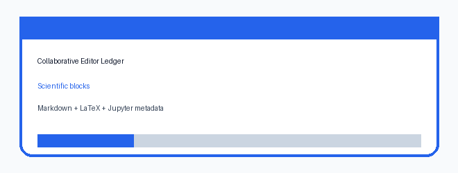

# Collaborative Editor Operation Ledger

This module is a credential-free real-time collaborative research editor
milestone for SCIBASE.AI issue #12. It models scientific document blocks,
operation replay, live presence, section locks, comments, suggestions, tasks,
version snapshots, and publication outline export.

## What It Demonstrates

- Markdown, LaTeX, and Jupyter-style scientific blocks with metadata.
- Deterministic text and metadata operations that can be replayed for autosave
  or audit history.
- Live collaborator presence snapshots.
- Section locks for final figures, equations, or datasets.
- Inline comments anchored to scientific blocks.
- Suggestions that can be accepted as replayable edit operations.
- Task assignments linked to document sections or notebook cells.
- Named version snapshots and a publication outline export.

## Run The Demo

```bash
npm test
npm run demo
```

The demo prints a complete JSON report:

```bash
node src/demo.js
```

Expected highlights:

- introduction text includes the accepted suggestion and inserted humidity text;
- the notebook block has execution metadata;
- the equation block is locked by a collaborator;
- the outline has one open task and zero pending suggestions.

## Local API

```bash
npm run api
curl http://localhost:4240/health
curl http://localhost:4240/demo-report
```

## Demo Artifact



## Safety Notes

- No external identity, editor, notebook, or kernel service is required.
- The module focuses on deterministic state transitions and review governance.
- Locks and suggestions are represented as reviewable data, not hidden state.
