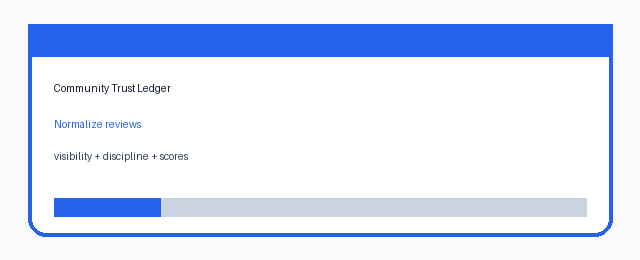

# Community Trust Ledger

This module is a credential-free community and reputation milestone for
SCIBASE.AI issue #15. It models structured peer review, inline comment anchors,
CRediT-style contributor attribution, transparent reputation scoring, badge
decisions, leaderboards, and project timeline evidence.

## What It Demonstrates

- Public, semi-private, and anonymous peer review visibility modes.
- Weighted review scoring across clarity, rigor, novelty, and reproducibility.
- Inline comments anchored to notebooks, datasets, code, or documents.
- CRediT-style contribution records for review, validation, data curation,
  software, writing, and supervision.
- Transparent reputation components instead of opaque "karma" totals.
- Badges for trusted reviewers, reproducibility mentors, and open science
  champions.
- Deterministic project timelines and leaderboards.

## Run The Demo

```bash
npm test
npm run demo
```

The demo prints a complete JSON report:

```bash
node src/demo.js
```

Expected highlights:

- Anonymous and semi-private review summaries are hidden.
- Low reproducibility scores produce a follow-up flag.
- Reputation output includes component-level scoring.
- Leaderboard ordering is deterministic.

## Local API

```bash
npm run api
curl http://localhost:4220/health
curl http://localhost:4220/demo-report
```

The API is read-only and uses only in-repo sample data.

## Demo Artifact



## Safety Notes

- No user identity provider or private profile data is required.
- Anonymous review mode hides public summary text in the normalized output.
- Scores are decomposed into named components so researchers can understand and
  contest reputation decisions.
