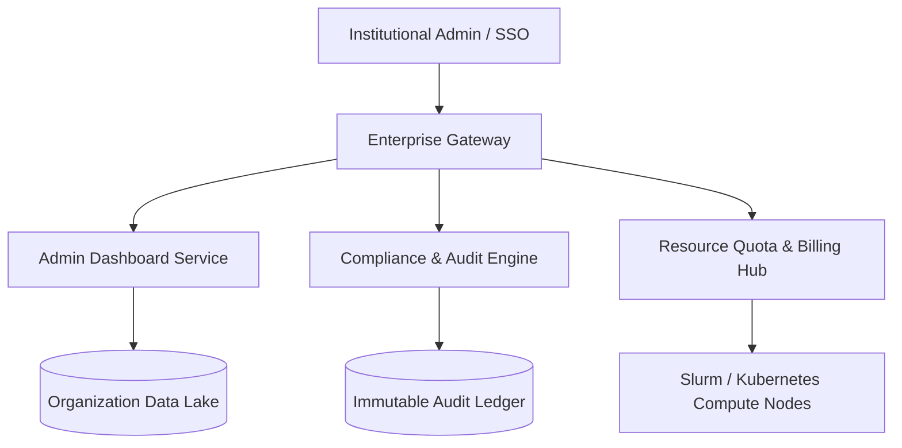

# 🏢 Enterprise Tooling & Governance Engine

> Architectural specification and system design for the SCIBASE Enterprise Administration, Analytics, and Institutional Compliance Suite.

---

## 1. Overview & Objectives

The Enterprise Tooling layer transforms SCIBASE into mission-critical infrastructure for universities, research institutes, and enterprise R&D divisions. It equips institutional administrators, department heads, and compliance officers with:
- **Centralized Administrative Dashboards:** Real-time visibility across research labs, compute quotas, and asset registries.
- **Role-Based Governance (RBAC) & Single Sign-On (SSO):** SAML 2.0 / OIDC integrations with institutional identity providers (Okta, Azure AD, Shibboleth).
- **Audit Logs & Export Pipelines:** Tamper-evident, compliance-ready event logs (SOC2, HIPAA, GDPR).
- **Automated Research IP & License Enforcement:** Policy engines ensuring proper dual-licensing, embargoes, and export compliance.

---

## 2. Institutional Architecture

---

## 3. Core Capabilities & Specifications

### A. Admin Dashboard & Contributor Analytics
- **Project Telemetry:** Real-time metrics on public/private repositories, active datasets, and model checkpoints.
- **Activity Heatmaps:** Cross-departmental collaboration graphs and researcher output velocity.
- **Compute & Storage Utilization:** Track GPU hours, cloud storage tiers (S3/GCS/Glacier), and egress quotas by department.

### B. SSO, SCIM & Identity Provisioning
- **Protocols Supported:** SAML 2.0, OpenID Connect (OIDC), OAuth2.
- **SCIM 2.0 Automated User Provisioning:** Automatically syncs lab members, roles, and project permissions directly from university Active Directory.
- **Multi-Tenant Hierarchy:** Organization → Department → Lab → Research Project.

### C. Security, Compliance & Audit Logging
- **Event Capture:** All sensitive actions (data access, IP downloads, role modifications, API key issuance) are recorded with cryptographically signed timestamps.
- **Export Formats:** Automated streaming to SIEM pipelines (Splunk, Datadog, AWS CloudWatch) in CEF/JSON format.

---

## 4. API Endpoints Reference

| Method | Endpoint | Description | Auth Scope |
| :--- | :--- | :--- | :--- |
| `GET` | `/api/v1/enterprise/overview` | Aggregated institutional stats & active compute | `admin:read` |
| `GET` | `/api/v1/enterprise/audit-logs` | Filterable, paginated compliance event stream | `audit:read` |
| `POST` | `/api/v1/enterprise/sso/config` | Update SAML/OIDC metadata & certificate bundles | `admin:write` |
| `GET` | `/api/v1/enterprise/quotas` | Departmental storage & GPU quota usage breakdown | `admin:read` |
| `POST` | `/api/v1/enterprise/export-report` | Generate SOC2/audit PDF & CSV compliance bundles | `admin:write` |

---

## 5. Security & Verification Checklist
- [x] SAML 2.0 assertions verified with SHA-256 signatures.
- [x] SCIM 2.0 token authentication with strict rate limits.
- [x] Audit logs stored in append-only immutable storage.
