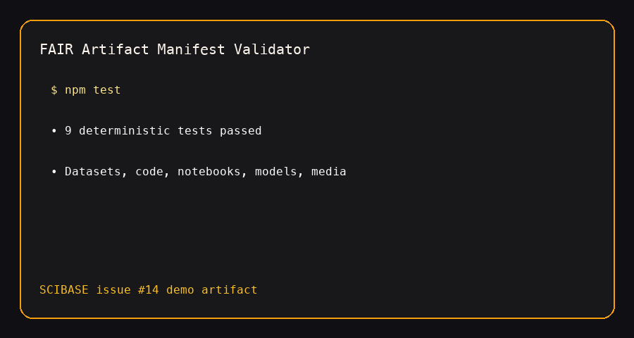

# FAIR Artifact Manifest Validator

This module adds a focused MVP for scientific data and code hosting. It validates research artifact manifests before storage, publication, DOI registration, or execution, giving reviewers a deterministic way to check whether datasets, code, notebooks, models, and supplemental files are reusable and machine-discoverable.

## Capabilities

- Detect artifact type from file extensions and declared media types.
- Validate required FAIR metadata: identifier, title, creators, license, access, keywords, and version.
- Summarize version changes for datasets and code artifacts.
- Generate JSON-LD, DataCite-style, and schema.org-style export payloads.
- Check executable environment readiness from Dockerfile, environment.yml, runtime, and command metadata.
- Score FAIR compliance across findable, accessible, interoperable, and reusable dimensions.
- Produce upload gate decisions for accepted, warning, or blocked artifacts.

## Quick Start

```bash
cd fair-artifact-manifest-validator
npm test
npm run demo
```

## Demo



## Example

```js
import { validateArtifactManifest } from "./src/artifact-validator.js";
import { sampleManifest } from "./src/sample-manifest.js";

const report = validateArtifactManifest(sampleManifest);
console.log(report.gate.status);
console.log(report.fairScore.total);
```

The implementation is dependency-free and avoids storage provider, payment, or container runtime assumptions. It is intended as the reviewable contract that a future upload service can call before persisting scientific assets.
