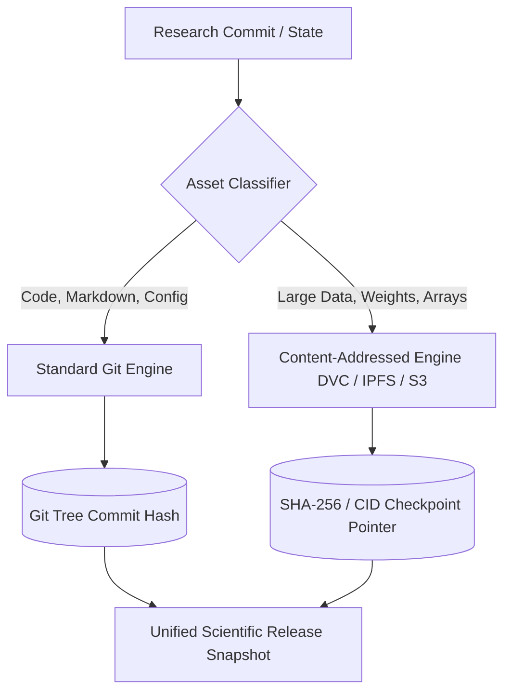

# 🔬 Scientific Project Repository & Version Control Engine

> Comprehensive architectural specification for the atomic unit of open scientific collaboration, hybrid Git/DVC versioning, and reproducible research execution on SCIBASE.

---

## 1. Overview & Vision

Each SCIBASE project repository functions as a **unified research container** combining the collaborative code-review power of GitHub, the interactive execution of Jupyter workspaces, and the academic rigor of scientific preprints.

It bundles:
* **Manuscripts:** Dynamic Markdown / LaTeX documents with live computational figures.
* **Datasets:** Multimodal data assets tracked via content-addressed storage (IPFS/DVC).
* **Code & Pipelines:** Production scripts, model architectures, and data transformation steps.
* **Environment Manifests:** Declarative container definitions (Docker, Conda, Nix) guaranteeing 100% computational reproducibility.

---

## 2. Standard Scientific Repository Structure

```text
├── manuscript/             # Structured scientific manuscripts (Markdown, LaTeX, Typst)
│   ├── main.md             # Primary manuscript with dynamic KaTeX equations
│   └── figures/            # Programmatically rendered SVG/PNG plots
├── data/                   # Structured data assets & pointers
│   ├── raw/                # Immutable raw datasets (read-only)
│   └── processed/          # Cleaned, standardized training & evaluation sets
├── code/                   # Production analysis scripts & modules
│   ├── src/                # Core algorithms & data pipelines
│   └── tests/              # Automated verification & sanity assertions
├── notebooks/              # Interactive exploration & computational narratives
│   └── analysis.ipynb      # Reproducible Jupyter/Marimo notebooks
├── models/                 # Model weights, checkpoints & serialized graphs
│   └── checkpoints/        # Git-LFS / DVC-tracked large binaries
├── env/                    # Environment & runtime definitions
│   ├── Dockerfile          # Root execution container
│   └── environment.yml     # Pinned Conda/Mamba dependencies
├── metadata.json           # CFF & Schema.org scientific metadata & ORCID IDs
└── README.md               # Public project overview & quickstart reproduction guide
```

---

## 3. Dual-Layer Version Control Architecture

Scientific projects deal with both small text files (code, papers) and massive binary assets (gigabyte/terabyte datasets, neural weights). SCIBASE implements a dual-layer versioning engine:



### Key Technical Mechanisms:
1. **Lightweight Git Metadata Pointers:** Big datasets generate `.dvc` or `.cid` pointer files committed to Git, while payload bytes are streamed to chunked object storage.
2. **Immutable Snapshot DOIs:** Freezing a release creates an immutable cryptographic hash linked to a persistent Digital Object Identifier (DOI).

---

## 4. Reproducibility & Containerized Execution Engine

To ensure that any researcher in the world can reproduce findings in 1 click:
* **Zero-Setup Cloud Runtime:** Every commit builds an isolated container image using root `env/Dockerfile`.
* **Hardware Binding:** Manifests specify exact GPU compute constraints (CUDA version, VRAM requirements, CPU cores).
* **Deterministic Seeds:** Runtime injection of global PRNG seeds across PyTorch, TensorFlow, and NumPy.

---

## 5. API & CLI Interface

```bash
# Initialize a new scientific repository
scibase repo init "quantum-coherence-study" --template physics

# Track and version a 10GB dataset
scibase data track data/raw/experiment_run_01.h5

# Execute fully reproducible validation pipeline
scibase run --reproduce
```

---

## 6. Verification & Standards Compliance
- [x] Full compliance with **FAIR Principles** (Findable, Accessible, Interoperable, Reusable).
- [x] Native **Citation File Format (CFF)** export for automated academic attribution.
- [x] Content-addressed SHA-256 integrity verification on all data assets.
