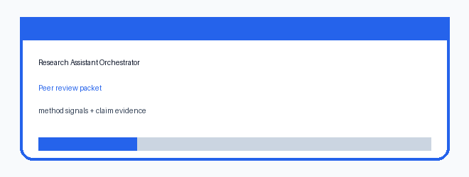

# Research Assistant Orchestrator

This module is a credential-free AI-powered research assistant suite milestone
for SCIBASE.AI issue #16. It coordinates three assistant surfaces in one
deterministic pipeline:

- auto peer-review packets;
- reproducibility runbooks;
- research-gap opportunity feeds.

No external model API is required. The module is designed so reviewers can
inspect the orchestration logic and run the same output every time.

## What It Demonstrates

- Domain-aware peer-review packets with method-signal checks.
- Claim-vs-evidence alignment for manuscript assertions.
- Reproducibility confidence scoring from required files, locked environments,
  and deterministic outputs.
- A repeatable execution plan for sandboxed reproducibility attempts.
- Corpus-scored research opportunities that prioritize unresolved questions,
  low replication, and negative results.
- A combined action plan that tells authors what to fix first.

## Run The Demo

```bash
npm test
npm run demo
```

The demo prints a complete JSON report:

```bash
node src/demo.js
```

Expected highlights:

- one unsupported manuscript claim is flagged;
- `data/manifest.json` and the unlocked environment are flagged in the
  reproducibility runbook;
- the top research-gap opportunity is `paper-b`;
- next actions cover peer review, reproducibility, and gap review.

## Local API

```bash
npm run api
curl http://localhost:4230/health
curl http://localhost:4230/demo-report
```

## Demo Artifact



## Safety Notes

- The module does not call live LLMs or require API keys.
- The report is evidence-linked and deterministic.
- Scores are advisory triage signals, not publication decisions.
