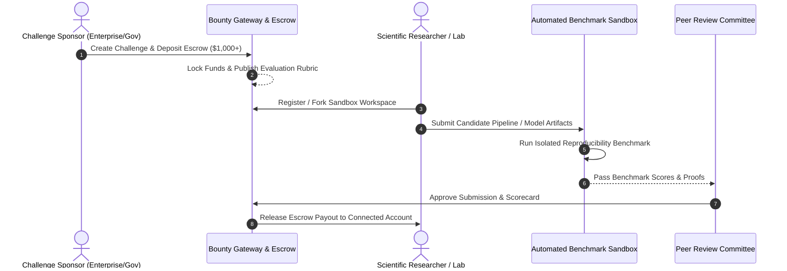

# 💰 Scientific Bounty & Research Marketplace Engine

> Comprehensive architectural specification and system design for the SCIBASE Open Innovation Marketplace, Escrow Engine, and Scientific Challenge Verification Suite.

---

## 1. Overview & Vision

The Scientific Bounty System transforms SCIBASE into a global, high-impact economic engine for applied research. It bridges commercial, academic, and governmental R&D challenges with global scientific talent through:
* **Structured Challenge Portals:** End-to-end management of problem definitions, computational benchmarks, and milestone schedules.
* **Non-Custodial Escrow & Milestone Payouts:** Milestone-based funding backed by institutional escrow (Stripe, Smart Contracts, Fiat Bank Transfers).
* **Automated Benchmark Verification:** Objective computational validation (accuracy, throughput, generalization) coupled with double-blind peer review.
* **Cryptographic IP & Provenance Protection:** Timestamped cryptographic commitments ensuring solver intellectual property rights.

---

## 2. End-to-End Bounty Lifecycle Architecture

---

## 3. Core Architecture & Modules

### A. Challenge Creation & Bounty Models
1. **Tiered Payout Structures:**
   * **Winner-Takes-All:** Fixed high-value bounty for the single highest-performing solution.
   * **Milestone-Based:** Progressive disbursements (e.g., 30% Architecture Plan, 40% Training/Data, 30% Final Peer-Reviewed Validation).
   * **Proportional Leaderboard:** Top 3-5 solvers split the reward pool based on normalized evaluation metrics.
2. **Challenge Specifications:**
   * Context & Problem Statement.
   * Input datasets, sample splits, and ground-truth validation criteria.
   * Licensing guidelines (Open Source Apache-2.0, MIT, or Institutional Dual-License).

---

### B. Secure Escrow & Payout Engine
* **Deposit Safeguards:** Sponsors fund 100% of the prize pool upfront prior to public listing.
* **Dispute Resolution & Timeouts:** Built-in mediation windows (14-day review window, 3-member arbitration council for contested results).
* **Multi-Currency Support:** Automated payouts in USD (via Stripe Connect direct bank deposits) and stablecoin assets.

---

### C. Automated Evaluation & Verification Sandbox
* **Containerized Execution:** Candidate models run in ephemeral Docker/K8s sandbox environments without internet egress.
* **Deterministic Metrics:** Real-time scoring against hidden test datasets (F1 Score, BLEU, RMSE, latency benchmarks).
* **Double-Blind Peer Review:** For theoretical whitepapers, submissions are stripped of researcher metadata and scored across originality, methodology, and rigor.

---

## 4. API Endpoints Reference

| Method | Endpoint | Description | Auth Scope |
| :--- | :--- | :--- | :--- |
| `POST` | `/api/v1/bounties` | Create a new scientific challenge and initialize escrow | `sponsor:write` |
| `GET` | `/api/v1/bounties` | List active challenges filtered by domain, prize, and deadline | `public:read` |
| `GET` | `/api/v1/bounties/:id` | Get challenge specifications, benchmark datasets, and rules | `public:read` |
| `POST` | `/api/v1/bounties/:id/submit` | Upload candidate model artifacts and code for sandbox verification | `solver:write` |
| `GET` | `/api/v1/bounties/:id/leaderboard` | View real-time benchmark scores and verified entries | `public:read` |
| `POST` | `/api/v1/bounties/:id/release-payout` | Authorize final escrow disbursement upon validation approval | `admin:write` |

---

## 5. Security & Intellectual Property Safeguards
- [x] Zero-knowledge cryptographic hashing of solver submissions prior to evaluation.
- [x] Ephemeral sandbox isolation preventing training data exfiltration.
- [x] Multi-signature authorization for high-value (> $10,000) escrow release.
