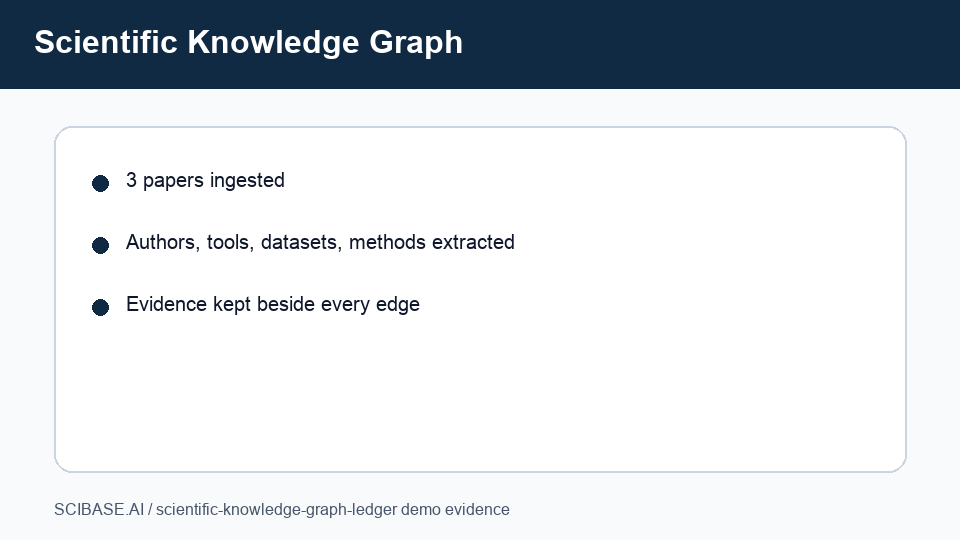

# Scientific Knowledge Graph Ledger

This module is a credential-free scientific knowledge graph milestone for
SCIBASE.AI issue #17. It turns sample research documents into typed entities,
relationships, graph search results, entity pages, schema.org-style JSON-LD,
and recommendation payloads.

## What It Demonstrates

- Deterministic entity extraction for authors, datasets, methods, tools,
  concepts, and DOI-like references.
- Evidence-backed relationships such as `authored`, `mentions`, `cites`, and
  `applied_to`.
- Graph search with query, type, and reproducibility filters.
- Entity page summaries with inbound/outbound relationship counts and usage
  contexts.
- JSON-LD export with schema.org-compatible node types.
- Personalized research recommendations from user interests, citations, and
  reproducibility scores.

## Run The Demo

```bash
npm test
npm run demo
```

The demo prints a complete JSON report:

```bash
node src/demo.js
```

Expected highlights:

- graph summary includes typed nodes and relationships;
- notebook search returns high-reproducibility documents;
- `tool:jupyter` has a generated entity page;
- recommendations prioritize the reproducibility tools document.

## Local API

```bash
npm run api
curl http://localhost:4250/health
curl http://localhost:4250/demo-report
```

## Demo Artifact



## Safety Notes

- No external NLP, graph database, or model credentials are required.
- Relationship evidence is carried forward in the graph for reviewability.
- Recommendation scores are transparent and deterministic.
